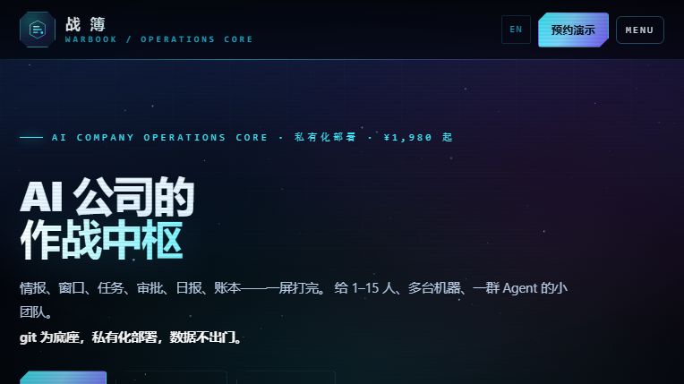

# 战簿 WarBook

> **AI 公司的作战中枢。**
>
> 情报侦察 · 窗口倒排 · 任务舰队 · 创始人审批 · 日报聚合 · 项目账本  
> git 为底座 · 私有化部署 · 数据不出门

官网：**https://warbook.mengstone.com/**  
在线看板：**https://warbook.mengstone.com/**  
版本：**v1.0 · BUILD 2026.10**  
起步价：**¥1,980**



---

## 一句话

战簿不是“又一个项目管理工具”。

它解决的是 **1–15 人 AI 小团队** 的真实问题：

```text
信息在群里
窗口在脑子里
任务在表格里
审批在聊天记录里
日报靠人催
账本在老板的 Excel 里
```

战簿把这些东西收进一个 **git 底座、私有化部署、零云依赖** 的作战盘。

---

## 六个模块，一套状态

| 模块 | 解决的问题 | 输出 |
|---|---|---|
| 情报侦察 | 竞品、平台、政策、市场变化散落 | 可追踪的情报条目 |
| 窗口倒排 | 发行窗口、活动节点、申报截止靠记 | 倒排时间线与负责人 |
| 任务舰队 | 任务分不清优先级和依赖 | 任务、状态、阻塞点 |
| 创始人审批 | 审批埋在聊天记录里 | 可追溯的审批记录 |
| 日报聚合 | 每天催日报、信息重复 | 自动聚合的日报 |
| 项目账本 | 钱、成本、回款对不上 | 项目级账本与证据 |

核心不是“再建一个表”，而是让 **情报 → 窗口 → 任务 → 审批 → 日报 → 账本** 在一张盘上闭环。

---

## 为什么是 git

大部分团队工具把数据放在厂商云上。

战簿反过来：

- **git 为底座**：状态、记录、变更可追溯
- **私有化部署**：装在自己的机器/仓库里
- **纯本地**：零云依赖
- **数据不出门**：适合对保密敏感的小团队

对独立游戏工作室、一人公司、企业 AI 转型团队，这比“多一个 SaaS 账号”更重要。

---

## 适合谁

- 1–15 人的 AI 小团队
- 独立游戏工作室
- 一人公司 / 小工作室
- 企业内部的 AI 转型小组
- 多台机器、多个 Agent 协同的团队

## 不适合谁

- 需要完整 ERP / 财务总账的大型企业
- 只想找一个免费看板、不愿意做任何配置的人
- 需要厂商托管、完全不想碰 git 的团队

---

## 页面里反复强调的三件事

### 1. 不给客户背书，给可核验的运行证据

战簿的卖点不是“用了就成功”，而是：

- 任务有没有人负责
- 窗口有没有倒排
- 审批有没有记录
- 日报是不是自动聚合
- 账本能不能对上

### 2. 不搞大迁移，先跑一条线

不需要把公司所有流程一次性搬进来。  
先选一条业务线，把情报、任务、审批、日报、账本跑通，再扩展。

### 3. 一次买断，不绑架订阅

官网定价 **¥1,980 起**，具体授权与部署方式以官网为准。  
不是“按人头无限涨价”的订阅故事。

---

## 30 分钟演示

官网提供：

- 预约演示
- 在线作战看板
- 战力扫描
- 模板下载
- 私有化部署说明

先用战簿自己的作战盘跑一遍你的场景；不合适会直接说，并告诉你该选什么。

**预约入口：https://warbook.mengstone.com/**

---

## English overview

**WarBook** is an operations core for small AI companies (1–15 people).

Six modules in one board:

- intelligence scouting
- launch-window countdown
- task fleet
- founder approvals
- daily-report aggregation
- project ledger

It is built on **git**, deployed privately, and runs with **zero cloud dependencies**, so operational data stays inside the team.

Starting price: **¥1,980**.  
Official site / demo: **https://warbook.mengstone.com/**

It is not a generic project-management SaaS; it is a private operating board for small teams juggling many machines, agents and launch windows.

---

## 说明

- 这是产品介绍仓库，不是开源代码仓库。
- 价格、授权、部署方式以官网为准。
- “1–15 人”“六个模块”“零云依赖”等描述来自官网当前版本。
- 由萌石科技团队维护。

**官网：https://warbook.mengstone.com/**
